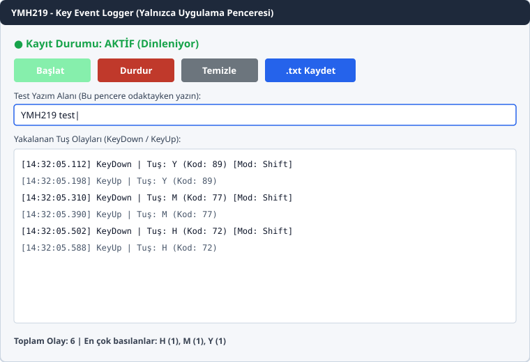
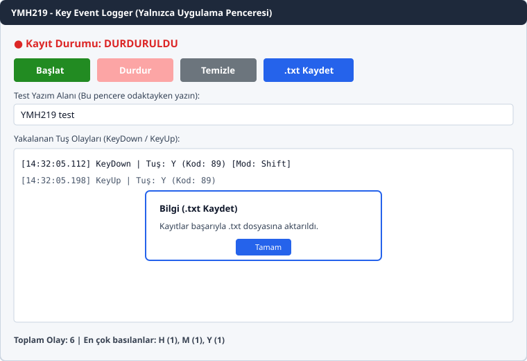

# YMH219-KeyEventLogger

## 1. Proje Adı ve Kısa Açıklama
**YMH219-KeyEventLogger**, YMH219 dersi kapsamında geliştirilmiş, yalnızca kendi uygulama penceresi odaktayken (focused) klavye olaylarını yakalayan, listeleyen, istatistiklerini tutan ve metin dosyasına kaydedebilen eğitsel bir Windows Forms uygulamasıdır.

## 2. Kullanılan Teknoloji / NuGet Paketleri
- **Programlama Dili:** C# 12
- **Çatı (Framework):** .NET 8.0 Windows Forms (`net8.0-windows`)
- **Dosya İşlemleri:** `System.IO.StreamWriter` (.NET Standart Kütüphanesi; harici bir NuGet paketi gerektirmez)

## 3. Kurulum ve Çalıştırma Adımları
Projeyi çalıştırmak için aşağıdaki iki yöntemden birini kullanabilirsiniz:

### Yöntem 1: Visual Studio 2022 ile
1. Depoyu bilgisayarınıza klonlayın veya indirin.
2. Kök dizindeki `KeyEventLogger.sln` dosyasını Visual Studio 2022 ile açın.
3. `F5` tuşuna basarak veya **Başlat** butonuna tıklayarak uygulamayı derleyip çalıştırın.

### Yöntem 2: .NET CLI ile
Terminal veya Komut İstemi üzerinden proje kök dizininde aşağıdaki komutu çalıştırın:
```bash
dotnet run --project KeyEventLogger/KeyEventLogger.csproj
```

## 4. Uygulamanın Temel Özellikleri
- **KeyEventRecord:** Yakalanan her klavye olayının zaman damgası, tuş kodu ve karakter bilgilerini tutan kayıt modeli.
- **KeyLogManager:** Klavye kayıtlarını yöneten, listeleyen, istatistikleri hesaplayan ve `.txt` formatında dışa aktaran yönetim sınıfı.
- **MainForm:** Kullanıcı arayüzünü ve klavye olay dinleyicilerini barındıran ana form.
- **Kontrol Butonları:**
  - **Başlat:** Klavye olaylarını kaydetmeye başlar.
  - **Durdur:** Aktif kaydı duraklatır.
  - **Temizle:** Ekrandaki mevcut kayıt listesini ve istatistikleri temizler.
  - **.txt Kaydet:** Kaydedilen klavye olaylarını `System.IO.StreamWriter` kullanarak `.txt` dosyasına aktarır.
- **Aktif Durum Göstergesi:** Kaydın o anda aktif olup olmadığını görsel olarak belirten durum göstergesi.
- **Tuş İstatistikleri:** Toplam basılan tuş sayısı ve tuş olaylarına dair özet istatistikler.

## 5. Ekran Görüntüleri
### Aktif Kayıt Durumu


### Kayıt Durduruldu Durumu


## 6. Bilinen Sınırlamalar / Geliştirme Notları
- Uygulama güvenlik ve eğitim ilkeleri gereği **yalnızca kendi penceresi odaktayken** basılan tuşları yakalar.
- Sistem genelinde (global) klavye kancası (global hook) kullanılmamaktadır; başka uygulamalar veya pencereler odaktayken tuş vuruşları kaydedilmez.

## 7. Öğrencinin Adı-Soyadı ve Öğrenci Numarası
- **Adı-Soyadı:** Ahmed Al Hamed
- **Öğrenci Numarası:** 225541606
